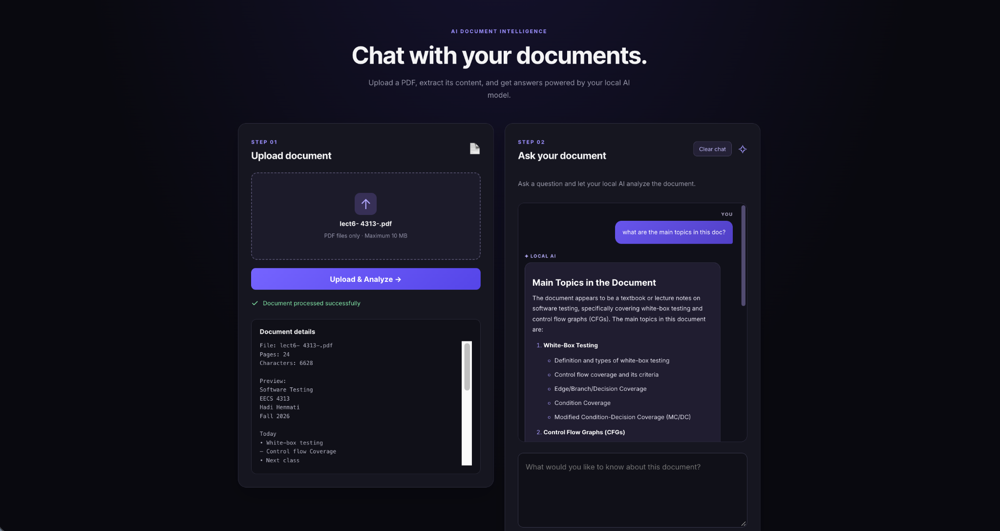

# DocuMind — AI Document Intelligence Platform

An AI-powered document assistant that allows users to upload PDF documents and ask questions about their contents using a locally hosted language model.

## Features

- **PDF Upload & Processing:** Upload PDF documents and extract text for analysis.
- **AI-Powered Question Answering:** Ask natural-language questions about uploaded documents.
- **Retrieval-Augmented Generation (RAG):** Retrieve relevant document excerpts using TF-IDF and cosine similarity.
- **Document Summarization:** Identify key topics and generate summaries of uploaded documents.
- **Source References:** Display supporting PDF page numbers alongside AI-generated responses.
- **Local AI Inference:** Run the Llama 3.2 model locally through Ollama.
- **Interactive Interface:** Responsive chat interface built with React and TypeScript.
- **Automated Backend Testing:** Validate PDF uploads, API responses, file-size restrictions, and AI integration using pytest.

## Tech Stack

| Layer | Technologies |
|---|---|
| Frontend | React, TypeScript, Vite, CSS |
| Backend | Python, FastAPI |
| AI Model | Llama 3.2 (3B), Ollama |
| Retrieval | TF-IDF, cosine similarity, scikit-learn |
| PDF Processing | PyMuPDF |
| Testing | pytest, FastAPI TestClient, unittest.mock |
| Version Control | Git, GitHub |

## How It Works

1. A user uploads a PDF document.
2. The backend extracts the document's text and divides it into searchable chunks.
3. TF-IDF converts the chunks into numerical representations.
4. When the user asks a question, the application retrieves relevant document content.
5. The retrieved context and question are sent to the local language model.
6. The application displays the generated answer and supporting page references.

## Getting Started

### Prerequisites

- Python 3.12
- Node.js and npm
- Ollama
- Llama 3.2 (3B) installed through Ollama

### Backend Setup

From the project root:

```bash
cd backend
python3 -m venv .venv
source .venv/bin/activate
python -m pip install -r requirements.txt
python -m uvicorn main:app --reload --port 8000
```

The backend runs at `http://127.0.0.1:8000`.

### Local AI Model

Install the model:

```bash
ollama pull llama3.2:3b
```

Start Ollama if it is not already running:

```bash
ollama serve
```

If Ollama is already running, you do not need to start another instance.

### Frontend Setup

Open another terminal from the project root:

```bash
cd frontend
npm install
npm run dev
```

Open the local URL displayed by Vite, usually `http://localhost:5173`.

## Automated Testing

DocuMind includes automated backend tests built with pytest and FastAPI TestClient.

The test suite verifies:

- API health endpoint responses
- Rejection of non-PDF uploads
- Successful PDF text extraction and processing
- Enforcement of the 10 MB upload limit
- AI question answering using mocked Ollama responses
- Error handling when Ollama is unavailable

To run the tests, navigate to the backend directory with the Python virtual environment activated:

```bash
cd backend
source .venv/bin/activate
python -m pytest -v
```

The current test suite contains **6 passing tests**.

Ollama responses are mocked during automated testing, allowing the tests to run without requiring a live language model.

## Current Limitations

- Only one uploaded document is stored at a time.
- Uploaded documents are stored in memory and cleared when the backend restarts.
- The application requires a locally running Ollama instance for AI-generated answers.
- Retrieval currently uses TF-IDF rather than neural embeddings or a vector database.

## Future Improvements

- Support for multiple uploaded documents
- Semantic retrieval using embeddings and a vector database
- Persistent document storage
- Deployment and continuous integration
- Improved retrieval accuracy and citation relevance

## Project Status

**Functional local MVP — ongoing improvements.**

Core PDF processing, document retrieval, AI question answering, source references, and automated backend testing are implemented.

## Application Preview


